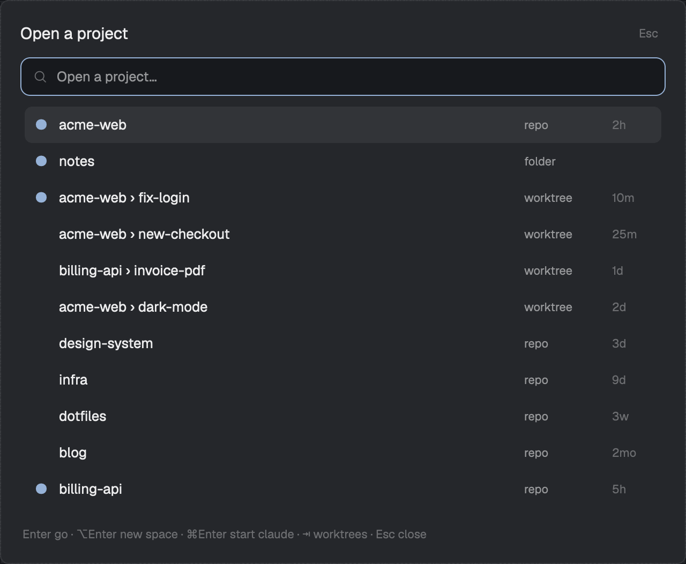

# Trailhead

[](https://github.com/andrebras/herdr-trailhead/actions/workflows/ci.yml)
[](LICENSE)

A project picker for the [Herdr](https://herdr.dev) desktop app. Press Cmd+O, type a few letters, press Enter: you are in that project's space, or a new one.



## Why Trailhead

- **It finds your projects.** Git repos and worktrees under your code folders, with nothing else to install. [zoxide](https://github.com/ajeetdsouza/zoxide) is optional and only sharpens the order.
- **Enter never closes anything.** It goes to the project's open space, or makes one in its folder.
- **Cmd+O, Enter jumps back.** With nothing typed, the project you were in before is selected.
- **Cmd+Enter starts your agent there:** `claude`, unless you choose another.

Each row shows its space's agent status, its kind and its last change. Projects on the other machines Herdr is connected to are listed too: type `@` and pick a machine to see only its projects.

[herdr-app-navigator](https://github.com/alizdavoodi/herdr-app-navigator) lists zoxide's folders, so it needs zoxide on each machine you want listed. [project-finder](https://github.com/mike-bronner/herdr-plugin-project-finder) makes Enter apply a set of ticks, which also closes the spaces you untick.

## Install

Give the coding agent you run in Herdr this line:

```text
Read ~/.config/herdr-app/AGENTS.md, then add this mod: https://github.com/andrebras/herdr-trailhead
```

Or by hand:

```sh
git clone https://github.com/andrebras/herdr-trailhead.git
cp -R herdr-trailhead/mods/trailhead ~/.config/herdr-app/mods/
herdr-app check ~/.config/herdr-app/mods/trailhead
```

Then bind a key in the `global` section of `~/.config/herdr-app/keys.json`. Herdr's default keys leave both of these free:

```text
"cmd-o": "mod.open:trailhead"        macOS
"ctrl-alt-o": "mod.open:trailhead"   Linux and Windows
```

Herdr's command palette has it too, as "Open a project". If you set `HERDR_APP_HOME`, use that folder instead of `~/.config/herdr-app`. To update, replace `mods/trailhead` with a fresh copy.

## Keys

| Key                                        | What it does                                                    |
| ------------------------------------------ | --------------------------------------------------------------- |
| Enter, or a click                          | Go to the project's space, or make one in its folder            |
| Alt+Enter or Shift+Enter                   | Make a new space there, even if one is open                     |
| Cmd+Enter (Ctrl+Enter on Linux/Windows)    | Go there and start your agent, in a new tab or a new space      |
| ↑ ↓, Ctrl+P / Ctrl+N                       | Move the selection                                              |
| Type a path, such as `~/code/app`          | List that folder first, so Enter opens a space there            |
| `@`, then Space, Tab or Enter on a machine | Show only that machine's projects (`@dev` narrows the machines) |
| A click on a row's machine                 | Show only that machine's projects                               |
| Backspace in an empty search               | Remove the machine filter                                       |
| Esc                                        | Close                                                           |

The popup's bottom line shows these keys for your platform. `@` and the machine column work only while another machine is connected; with none, `@` is just a letter.

## Settings

Settings live in `~/.config/herdr-app/trailhead.json`, outside the mod's folder, so updates never reset them. Every key is optional. Trailhead reads the file each time it opens.

```json
{
  "roots": ["~/code", "~/work"],
  "depth": 3,
  "folders": ["~/notes"],
  "agent": ["claude", "--continue"],
  "zoxide": "auto"
}
```

| Setting   | Default                   | What it does                                                               |
| --------- | ------------------------- | -------------------------------------------------------------------------- |
| `roots`   | the code folders you have | Folders searched for git repos and worktrees                               |
| `depth`   | `3`                       | How many levels below each root to search, from 1 to 6                     |
| `folders` | `[]`                      | Folders listed as they are, git or not                                     |
| `agent`   | `["claude"]`              | What Cmd+Enter starts, as a list: `["codex"]`, `["~/bin/start-work"]`      |
| `zoxide`  | `"auto"`                  | `"auto"` uses zoxide's ranking when it is installed; `"off"` never runs it |

Without `roots`, Trailhead searches whichever of these exist: `~/code`, `~/projects`, `~/src`, `~/dev`, `~/Developer`, `~/work`, `~/git`, `~/repos` and `~/Lab` (and `~/Code`, `~/Projects`). A bad value, or a root you set that is missing or can't be read, shows as one red line at the top of the popup; a bad value falls back to its default.

## How it works

- **Finding.** It walks each root up to `depth` levels. A folder with a `.git` folder is a repo; one with a `.git` file is a worktree. It skips hidden folders and `node_modules`, never looks inside a repo, and stops after 5,000 folders.
- **Last change.** The time of the last entry in the repo's reflog: a commit, checkout or pull.
- **Opening.** The list from last time draws in the first frame. Then the folders are read again, and rows update in place without moving your selection.
- **Order.** With nothing typed: the previous project, your open spaces, recent picks, then the rest by last change, and the current space last. Typed: a fuzzy match on the name, then on the path, with open spaces, recent picks and zoxide breaking ties. It shows the best 12 rows.
- **Other machines.** Through Herdr, it runs one small `sh` script on each connected machine, with the same roots and depth and a 2-second limit. Missing roots are skipped quietly there. Their rows show no age. They hide while the machine can't be reached, and leave the list when you remove it from Herdr.

[RECIPE.md](RECIPE.md) has the full rules.

## What it reads and runs

- **Reads:** `trailhead.json` (and `projects.json`, a legacy fallback) in Herdr's folder, the folder names under your roots, and the `.git` entries and reflogs of the repos it finds. Herdr lets mods read only inside your home folder.
- **Runs:** `zoxide query -ls` once per open, when zoxide is installed. On Cmd+Enter, `command -v` (`where` on Windows) to check that the agent is installed. On each other machine, the `sh` script above.
- **Asks Herdr to:** select a space, make a space or add a tab. Nothing else, and never to close anything.
- **Stores:** your recent picks and the last list it found, in the mod's storage in Herdr's folder. It makes no network requests.

## More

- [RECIPE.md](RECIPE.md): the brief to rebuild Trailhead from scratch.
- [CHANGELOG.md](CHANGELOG.md): what changed in each version.
- [CONTRIBUTING.md](CONTRIBUTING.md): set up, run the checks, send a change.
- [SECURITY.md](SECURITY.md): report a vulnerability privately.
- [Apache License 2.0](LICENSE).
