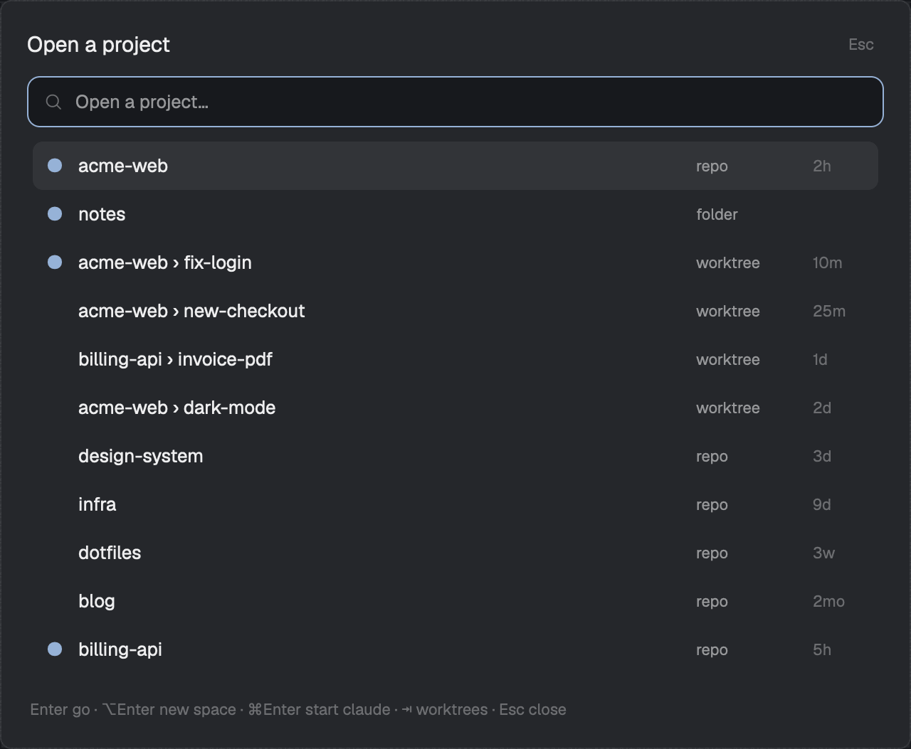

# Trailhead

A popup for opening projects. Cmd+O opens it at the top of the window: a search field over a short list of projects, which are the git repos and worktrees under the person's code folders, folders they list, and the spaces already open. Enter goes to the project's open space, or makes a new space in its folder. With nothing typed, the project the person was in before is selected, so Cmd+O then Enter jumps back.

## What you see

- **The popup:** an overlay at the top of the window, 40px down, 640px wide, at most 80% of the window's height. Background `popover`, padding 18px, 10px between its parts. Text 13px.
- **Header:** "Open a project" (15px, semibold, `foreground`) on the left. A small "Esc" button on the right (11px, `dim`, 6x2px padding, radius 5) that turns `hover` with `foreground` text on hover and closes the popup.
- **Error line:** shown only when something is wrong. One line, 11.5px, `blocked` colour, cut with an ellipsis. When there are several problems, it shows the first and "(and N more)".
- **Search field:** 36px high, radius 9, 1px `accent` border, `background` fill. A 15px magnifier icon (`dim`), the machine pill while the list is filtered to one machine, and the input (12.8px, `foreground`), placeholder "Open a project…".
- **Pills:** `@<machine>` (`@local`, `@devbox`) for the machine filter, then `<repo> ›` (`acme-web ›`) for the repo filter. Each 11.5px, `foreground` on `hover`, 6x1px padding, radius 5.
- **Rows:** at most 12. Each row is 34px high, radius 7, 4px side margin, 10px padding and 10px gaps. The selected row and a hovered row are filled with `hover`. Left to right:
  - **Dot** (12px wide): `●` for an open space, coloured by its agent status. A typed path shows a `dim` `+`, a machine an `accent` `@`. Other rows show nothing.
  - **Name** (fills the space, `foreground`, cut when too long): the letters that match the query are semibold `accent`. A worktree whose branch is known shows `<repo> › <branch>` (`acme-web › fix-login`).
  - **Machine** (80px, 11px, `muted`, `foreground` on hover): the machine's name, or `local`. Present only while another machine is connected and the list isn't filtered to one machine or narrowed to one repo. Blank on a machine row.
  - **Kind** (72px, 11px, `muted`): `repo`, `worktree`, `folder`, `machine`, `open folder` for a typed path, or `no such folder` in `blocked` colour. Blank for a space that matches no project.
  - **Age** (36px, 11px, `dim`): `now`, `5m`, `3h`, `2d`, `3w`, `4mo` or `2y`. Blank when unknown.
- **Empty list:** one 12px `dim` line: "Looking for projects…" before the first list exists, "No machine's name starts with that." when `@` matches no machine, "No project matches. Type a path (~/code/app) to open any folder." when a query matches nothing, and "No projects found. Set "roots" in trailhead.json in Herdr's folder to the folders that hold them." otherwise.
- **Footer:** 11px, `dim`. On macOS: `Enter go · ⌥Enter new space · ⌘Enter start <agent> · Esc close`. Elsewhere: `Alt+Enter` and `Ctrl+Enter` instead. `<agent>` is the last part of the agent program's path. Before `Esc close`: `@ machine` while the Machine column shows, `⇥ worktrees` (`Tab worktrees` elsewhere) while the selected row has worktrees and no repo pill shows, and `⌫ remove filter` (`Backspace remove filter` elsewhere) while a pill shows.

## How it behaves

- **Agent status:** the dot is `working`, `blocked`, `done` or `idle` in Herdr's own theme colours. An open space with no agent status uses `accent`.
- **Names:** a project is named after its folder. A worktree is named `<repo>/<folder>` (`acme-web/login`), which is what a space made for it is called; it shows as `<repo> › <branch>` when its branch is known, and that is what a query matches (its path still matches too). When names clash, each takes the shortest end of its path that the others don't share (`work/billing`, `side/billing`). An open space shows its own name, except in a worktree whose branch is known, where it shows `<repo> › <branch>` like the worktree.
- **Nothing typed:** the order is (1) the previous project, selected; (2) the other open spaces, in the sidebar's order; (3) the other recent picks, newest first; (4) the rest, newest change first, then those with no known change by name; (5) the current space, last. "Previous" is the newest recent pick that isn't the current space. Each open records the current space as a recent pick, so spaces reached from the sidebar count.
- **Typing:** each row scores against the lowercase query: the name starts with it (400 minus the name's length), contains it (300 minus), has its letters in order (200 minus), the shown path contains it (at least 101), or the path has its letters in order (at least 1). Then a bonus: 10 for an open space (15 when its agent is blocked), up to 10 for a recent pick (10 minus its place), and up to 5 from zoxide's ranking (5 for its first 20 folders, down to 1, none past 100). The best 12 show, ties in list order. The current space gets no recent-pick bonus.
- **A typed path** (starting with `~`, `/`, `\` or a drive such as `C:\`): that folder is the first row, then the projects inside it.
- **Enter or a click:** go to the project's open space, or make a space in its folder named after it. Its open space is the one made in that folder, else one with a terminal in or under it, on the same machine.
- **Alt+Enter or Shift+Enter:** make a new space even if one is open.
- **Cmd+Enter (Ctrl+Enter on Linux and Windows):** first check that the agent program is installed on the project's machine. If not, the error line says "`<program>` isn't installed on this computer. Change "agent" in trailhead.json in Herdr's folder." and the popup stays open; typing clears the line. If so: add a tab running the agent to the open space, or make a new space whose first terminal runs it.
- **A typed folder in the home folder that doesn't exist:** Enter does nothing, and its kind turns to `no such folder`.
- **Machine filter:** only while another machine is connected. A lone `@` lists the machines as rows: `local` (this computer), then each machine Herdr lists that isn't `unavailable`. `@dev` keeps those whose name starts with `dev`, letter case ignored. Space, Tab or Enter on a machine row, or a click on it, filters the list to that machine: it shows as the pill, the typed `@dev ` leaves the input, and only that machine's rows show, ranked and ordered as usual, without the Machine column. Typing `@dev ` and more at once filters to the selected machine row when it matches, else the first that does, and keeps what follows the space. A click on a row's machine name filters the same way. Backspace in an input that was already empty removes a pill: the repo's first, then the machine's. Each open starts with no filter. With no other machine, `@` is typed text. While another machine is the filter, a typed path is matched as text, not opened as a folder.
- **Repo filter:** Tab on a repo that has a worktree in the list, or on one of its worktrees, narrows the list to that repo and its worktrees on its machine, including open spaces in them, and empties the input. It shows as the `<repo> ›` pill. A worktree belongs to the repo its `gitdir:` points into. Tab is kept by the popup either way, so it never moves the keyboard. In the view the repo comes first, then its worktrees (ordered or ranked as usual), each showing only its branch (its folder's name when detached), indented 32px on the left, and the Machine column is hidden.
- **Keys:** ↑/↓ and Ctrl+P/Ctrl+N move the selection and wrap at both ends. Esc closes. Typing resets the selection to the first row.
- **Live updates:** the kept list draws first. When the scan, the ages, zoxide or another machine's results arrive, the rows rebuild and the same row stays selected. Agent status changes redraw the dots.
- **Never:** closes a space, creates a folder, or touches the network.

## Built from

- **Mod:** `mods/trailhead/` with `mod.json`: `place: "none"`, an overlay of kind `popup` at `top`, offset 40, width 640, height 0.8, and a palette entry "Open a project" (`mod.open {name: "trailhead"}`, words `folder repo git space sessionizer trailhead`). `keys.json` binds `cmd-o` to `mod.open:trailhead`.
- **Files:** `main.js` (the view, the folder walk, spaces), and modules that import nothing from Herdr: `match.js` (scoring, order, ages, reflog times, highlights, unique names), `paths.js` (separators, `~`, home checks), `settings.js` (reading and checking `trailhead.json`), `kept.js` (the list kept between opens), `actions.js` (the command for each key, the installed check), `remote.js` (the other-machine script and its output), `spaces.js` (open spaces, which space a project has, the rows and their labels), `keys.js` (the keys that tell rows apart) and `filter.js` (the filters: what `@` lists, the rows of one machine, and which repo a row belongs to). `search.svg` is the magnifier.
- **Herdr functions:** `spaces`, `panes`, `machines`, `run`, `exec`, `theme`, `props`, `closeOverlay`, `home`, `appHome`, `checking`. Files through `fs/promises` (`readFile`, `readdir`). `platform` from `os` picks the footer.
- **Commands:** `space.select {id}`, `space.new {folder, name, argv?, machine?}`, `tab.new {space, folder, argv}`.
- **Settings:** `trailhead.json` in `appHome()`, keys `roots`, `depth` (1 to 6), `folders`, `agent` (a non-empty list of strings), `zoxide` (`"auto"` or `"off"`). Keys it lacks come from `projects.json` there, a legacy file. A bad value is reported and replaced by its default.
- **Finding:** walk each root `depth` levels with `readdir`. A folder holding a `.git` folder is a repo, its reflog at `.git/logs/HEAD`. A `.git` file is a worktree: its `gitdir:` line points at `<repo>/.git/worktrees/<name>`, whose `logs/HEAD` is its reflog and whose `HEAD` names its branch (`ref: refs/heads/<branch>`; a detached HEAD names none). Don't descend into a repo, hidden folders or `node_modules`. Stop after 5,000 folders. Then, for each repo found, read git's own record of its worktrees: each folder in `<repo>/.git/worktrees/` has a `gitdir` file holding the path to the worktree's `.git` file (absolute, or relative to that folder) and a `HEAD`. Add each one the walk didn't find whose folder is in the home folder and can be read, so worktrees inside a repo (`.claude/worktrees/`) or in hidden folders (`~/.codex/worktrees/`) are listed and searchable too; one outside the home folder (`/private/tmp/...`) is skipped, as mods can't read there. This runs after the first frame, with the rest of the search. Then add each entry of `folders`, kind `folder`.
- **Programs:** `zoxide query -ls` with a 2-second limit, once per open. On Cmd+Enter, with a 3-second limit on the project's machine: `sh -c <check> sh <program>`, where the check expands a leading `~` to `$HOME`, runs `command -v` on it and prints the path to start; on Windows, `where <program>`. When `sh` can't start on another machine, try `where` there. On each machine from `machines()` that isn't `unavailable`, `exec("sh", ["-c", script], {on, timeout: 2000})`. The script walks each root with shell globs (`"$dir"/*/`, which skip hidden folders), skips links and `node_modules`, and stops at each repo. It prints `H <home>`, then `R <path>` per repo, `W <path>` per worktree followed by `D <gitdir>` and, when its `HEAD` names a branch, `B <branch>` (both read with sh's own `read`, so no program starts per worktree), and `E <root>` for a root that exists but can't be read.
- **Storage:** `localStorage` keys `trailhead.recent` (the keys of the last picks, newest first, at most 100: picking an open space stores both its space key and its project key) and `trailhead.list` (the last list found, with each row's age and each worktree's repo and branch, versioned).

## Watch out

- Mods may read only inside the home folder. A root outside it fails, and a listed or typed folder outside it is shown or opened without a check.
- The default roots are `~/code`, `~/Code`, `~/projects`, `~/Projects`, `~/src`, `~/dev`, `~/Developer`, `~/work`, `~/git`, `~/repos` and `~/Lab`. Search only those that exist under exactly that name, so `~/code` and `~/Code` on a case-insensitive disk count once, and say nothing about the others. A root set in `trailhead.json` that is missing on this computer is reported. On another machine a missing root is skipped quietly, since folders differ between machines. A root that exists but can't be read is always reported.
- `~` in `agent` means the home folder of the machine the agent runs on. Herdr starts the agent without a shell, so expand it in the installed check and start the expanded path. `where` on Windows takes no path, so a path there starts without a check.
- Rows from other machines have no age: their reflogs aren't read, though `readTextFile(path, {on})` could. Rows of a machine Herdr no longer lists are dropped, and those of a machine that is listed but unavailable are hidden until it is back.
- Never list a repo inside another repo. When filtering a sorted list of paths, compare by path segment, not plain string order: `app-two` sorts between `app` and `app/vendor`.
- Alt+Enter also reaches the input as a submit. Ignore a submit within 300ms of an Alt+Enter, or it opens twice.
- Popups take the keyboard a moment after opening: focus the input again after 600ms, but not during `herdr-app check`.
- Two spaces can share a folder, and a space can have no folder. Key space rows by machine and space id, project rows by machine and path, or the selection jumps between them.
- Herdr's theme names (`popover`, `hover`, `accent`, `blocked` and so on) are the only colours. Nothing is hard-coded.
- Keys reach the popup three ways: Enter as the input's submit, Space as a change to its text, and Tab and Backspace through the wrapper's `on_key_down`. Lock a machine in each. Decide that Backspace hit an empty input from the text as last drawn, not the input's value now, or deleting the last letter also removes the pill.
- The shown rows and the ranking index depend on the machine filter as well as the query: work them out again when it changes.
- A click on a row's machine name must stop there (`cx.stop_propagation()`), or the row's own click opens the project too.

## Done when

- `herdr-app check mods/trailhead` passes.
- Cmd+O opens the popup with the last list drawn at once, then updates without moving the selection.
- A repo, a worktree and a listed folder each show with the right kind and an age from their reflog.
- Two repos with the same folder name show as `work/billing` and `side/billing`.
- Open a project, then another, then Cmd+O and Enter: you are back in the first.
- Typing `aw` finds `acme-web`, with `a` and `w` highlighted.
- Alt+Enter makes a second space in a folder that already has one.
- Cmd+Enter with `"agent": ["claude"]` adds a tab running `claude`. With a program that doesn't exist, the error line says so and the popup stays open.
- With no `trailhead.json` and only `~/code` present, its repos show and no error line appears.
- `"depth": 9` shows an error line and searches 3 levels deep.
- Typing `~/nowhere` and Enter shows `no such folder`, and nothing opens.
- With a second machine connected, its projects show with its name in the Machine column, and Enter opens a space there.
- With a second machine connected, typing `@dev ` shows a `@devbox` pill and only devbox's projects, without the Machine column; Backspace removes the pill. Typing `@` with no other machine connected just searches for `@`.
- A worktree on branch `fix-login` of `acme-web` shows as `acme-web › fix-login` and is found by typing `fix`. Tab on it shows an `acme-web ›` pill, acme-web first and then its worktrees by branch; Backspace removes the pill.
- A worktree made inside its repo (`acme-web/.claude/worktrees/x`) or in a hidden folder is listed, and shows in acme-web's view.
